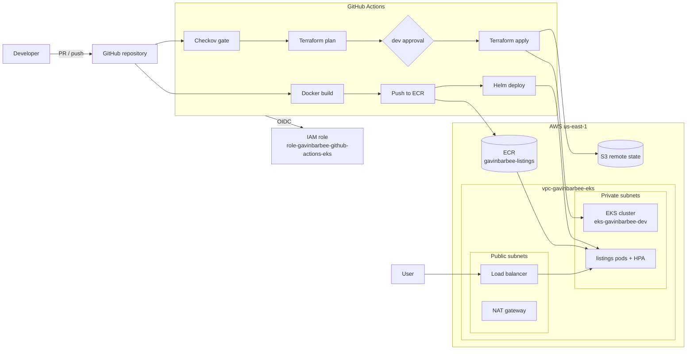

# AWS EKS Platform with Terraform and GitHub Actions

**Status:** 🚧 In progress

## Video Walkthrough

> Loom walkthrough coming soon.

## Project Overview

I built a container platform on AWS that deploys entirely through GitHub Actions. Terraform provisions a VPC and an Amazon EKS cluster behind a Checkov security gate, with every apply waiting for my approval on a saved plan. A second workflow builds the app image, pushes it to Amazon ECR tagged with the commit SHA, and ships it to EKS with Helm. The pipeline authenticates to AWS through OIDC federation, so no AWS access keys are stored in GitHub.

Once the platform is running, I test it the way a production team would: I load the app until the Horizontal Pod Autoscaler adds pods, then push a broken release and roll it back with Helm.

This is the AWS rebuild of my [Azure Terraform DevSecOps pipeline](https://github.com/gavinbarbee/azure-terraform-devsecops-pipeline), carrying the same OIDC, security-gate, and approval patterns across clouds.

### Skills Demonstrated

- **AWS networking:** VPC with public and private subnets across two Availability Zones, NAT gateway, and subnet tagging for Kubernetes load balancers
- **Amazon EKS:** managed node group on Amazon Linux 2023, EKS access entries for cluster-admin, core add-ons
- **Infrastructure as code:** Terraform with registry modules, S3 remote state with native locking, saved-plan workflow
- **CI/CD:** GitHub Actions with OIDC federation to AWS, Checkov gate with SARIF upload to code scanning, environment approval before apply
- **Containers:** Docker image built on a non-root NGINX base, pushed to Amazon ECR with immutable tags and scan-on-push
- **Kubernetes operations:** Helm chart with probes, resource limits, hardened security context, Horizontal Pod Autoscaler, and Helm rollback

## Architecture Diagram



## Prerequisites

- AWS account (I used my AWS Organizations management account) with the AWS CLI v2 signed in as an administrator
- Terraform 1.10 or later (needed for S3 native state locking)
- kubectl and Helm for local verification
- GitHub CLI (`gh`) signed in to my account
- Windows with PowerShell and VS Code

> **Cost note:** EKS bills about $0.10/hour for the control plane, plus two t3.medium nodes, a NAT gateway, and a load balancer. My estimate is roughly $6–8/day, so I tear it down as soon as I finish testing.

## Naming Conventions

| Resource | Name |
|---|---|
| GitHub repo | gavinbarbee/aws-eks-terraform-pipeline |
| State bucket | gavinbarbee-eks-tfstate-&lt;random suffix&gt; |
| GitHub Actions IAM role | role-gavinbarbee-github-actions-eks |
| VPC | vpc-gavinbarbee-eks |
| EKS cluster | eks-gavinbarbee-dev |
| Node group | default |
| ECR repository | gavinbarbee-listings |
| Helm release | listings |
| GitHub environment | dev |

## Project Steps

### 1. Create the project folder and repo

```powershell
cd $HOME\Desktop
mkdir aws-eks-terraform-pipeline
cd aws-eks-terraform-pipeline
git init -b main
```

I added the files from this repo, then created the GitHub repo:

```powershell
gh repo create gavinbarbee/aws-eks-terraform-pipeline --public `
  --description "AWS EKS platform with Terraform and GitHub Actions: OIDC auth, Checkov gate, ECR, Helm, autoscaling, and rollback" `
  --source . --remote origin
```

### 2. Sign in to AWS and get my admin ARN

EKS access entries need my IAM principal ARN without a path. When signed in through IAM Identity Center, `sts get-caller-identity` returns an assumed-role ARN, so I converted it to the role ARN:

```powershell
aws sts get-caller-identity
$acct = aws sts get-caller-identity --query Account --output text
$role = (aws sts get-caller-identity --query Arn --output text).Split('/')[1]
$adminArn = "arn:aws:iam::${acct}:role/$role"
$adminArn
```

> 📸 Screenshot: caller identity (account ID blurred)

### 3. Bootstrap the state bucket and OIDC role

The bootstrap stack runs locally once. It creates the S3 state bucket, the GitHub OIDC provider, and the IAM role the pipeline assumes.

```powershell
cd bootstrap
terraform init
terraform plan "-out=main.tfplan"
terraform apply main.tfplan
cd ..
```

> 📸 Screenshot: bootstrap apply output

### 4. Store pipeline settings as GitHub variables

None of these values are secrets, but I keep them out of the code:

```powershell
gh variable set AWS_REGION --body "us-east-1"
gh variable set AWS_ROLE_ARN --body (terraform -chdir=bootstrap output -raw github_actions_role_arn)
gh variable set TF_STATE_BUCKET --body (terraform -chdir=bootstrap output -raw state_bucket)
gh variable set ADMIN_PRINCIPAL_ARN --body $adminArn
gh variable list
```

### 5. Create the dev environment approval gate

In GitHub: **Settings → Environments → New environment → `dev`**, then I enabled **Required reviewers** and added myself. The apply job pauses here until I approve.

> 📸 Screenshot: dev environment with required reviewer

### 6. Open a pull request to run the security gate and plan

```powershell
git checkout -b feature/eks-platform
git status
git add .
git commit -m "feat: VPC, EKS, ECR, Helm chart, and pipelines"
git push -u origin feature/eks-platform
gh pr create --fill
```

Checkov scans the Terraform first. Results go to **Security → Code scanning** as SARIF, and the plan appears in the run summary.

> 📸 Screenshot: Checkov gate passing
> 📸 Screenshot: Terraform plan summary on the PR run

### 7. Merge and approve the apply

```powershell
gh pr merge --squash --delete-branch
git checkout main
git pull
```

The push to main produces a saved plan, then waits on the `dev` environment. I approved it in the Actions tab. EKS creation takes about 15 minutes.

> 📸 Screenshot: approval prompt
> 📸 Screenshot: successful apply

### 8. Connect kubectl from my machine

```powershell
aws eks update-kubeconfig --region us-east-1 --name eks-gavinbarbee-dev
kubectl get nodes
```

> 📸 Screenshot: two Ready nodes

### 9. Deploy the app

```powershell
gh workflow run deploy.yml
gh run watch
```

The workflow builds the image, pushes it to ECR tagged with the commit SHA, installs metrics-server, and runs `helm upgrade --install`. Then I checked the release and opened the load balancer address:

```powershell
kubectl get pods,svc,hpa
$lb = kubectl get svc listings -o jsonpath='{.status.loadBalancer.ingress[0].hostname}'
Start-Process "http://$lb"
```

> 📸 Screenshot: deploy workflow run
> 📸 Screenshot: listings page in the browser

### 10. Test autoscaling under load

In one terminal I watched the autoscaler:

```powershell
kubectl get hpa listings --watch
```

In a second terminal I generated load from inside the cluster:

```powershell
kubectl run load-generator --image=busybox:1.36 --restart=Never -- /bin/sh -c "while true; do wget -q -O- http://listings > /dev/null; done"
```

Once CPU passed the 50% target, the HPA scaled the deployment above 2 replicas. Then I stopped the load and watched it scale back down:

```powershell
kubectl delete pod load-generator
```

> 📸 Screenshot: HPA scaling up

### 11. Push a bad release and roll it back

I deployed a release that points to an image tag that doesn't exist, which simulates a broken deploy:

```powershell
helm upgrade listings helm/listings --reuse-values --set image.tag=does-not-exist
kubectl get pods
```

The new pods failed with `ImagePullBackOff`, and the old pods kept serving traffic because the new ones never passed readiness. Then I rolled back:

```powershell
helm history listings
helm rollback listings
kubectl get pods
```

> 📸 Screenshot: ImagePullBackOff on the bad release
> 📸 Screenshot: helm history after rollback

## Verification Checklist

- [ ] Bootstrap created the state bucket, OIDC provider, and IAM role
- [ ] No AWS access keys stored anywhere in GitHub
- [ ] Checkov results visible in code scanning
- [ ] Apply waited for my approval on the `dev` environment
- [ ] `kubectl get nodes` shows 2 Ready nodes
- [ ] Image in ECR tagged with the commit SHA, with a scan result
- [ ] Listings page loads from the load balancer address
- [ ] HPA scaled up under load and back down after
- [ ] Bad release failed without taking the site down, and `helm rollback` restored it

## Troubleshooting

| Issue | Cause | Fix |
|---|---|---|
| | | |

## Cleanup

The load balancer must be removed before Terraform destroys the VPC, or the destroy hangs on its network interfaces.

```powershell
helm uninstall listings
helm uninstall metrics-server --namespace kube-system

cd terraform
terraform init -backend-config="bucket=$(terraform -chdir=..\bootstrap output -raw state_bucket)"
terraform plan -destroy -var "admin_principal_arn=$adminArn" "-out=destroy.tfplan"
terraform apply destroy.tfplan
cd ..\bootstrap
terraform plan -destroy "-out=destroy.tfplan"
terraform apply destroy.tfplan
```

## Key Takeaways

_Written after the build._

---

*Built by Gavin Barbee · Time to complete: to be updated after the build*
